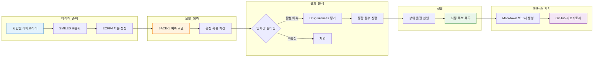

# CHEMBL BACE-1 Screening Example - BACE-1 활성 예측 결과 보고서

> **생성 일시**: 2026년 11월 23일 15:30
> **프로젝트**: CHEMBL BACE-1 Screening Example
> **분석 대상**: 100개 화합물

---

## 개요

이 보고서는 CHEMBL BACE-1 Screening Example의 BACE-1 (Beta-secretase 1) 억제 활성 예측 결과를 정리한 것입니다.

### 분석 대상

| 항목 | 값 |
|------|-----|
| 전체 화합물 수 | 100개 |
| BACE 활성 예측 물질 | 100개 (≥0.5) |
| 선별된 물질 | 20개 (상위) |
| 활성 예측 비율 | 100.00% |

### BACE-1 타겟 정보

**BACE-1** (Beta-secretase 1, β-secretase)는 알츠하이머병의 주요 병리학적 특징인 아밀로이드 베타 (Aβ) 펩타이드 생성에 관여하는 효소입니다. BACE-1 억제는 Aβ 생성을 감소시켜 알츠하이머병 진행을 늦출 수 있는 치료 전략으로 연구되고 있습니다.

---

## 방법론

### 모델 정보

| 항목 | 값 |
|------|-----|
| 모델 유형 | Random Forest Classifier |
| 학습 데이터셋 | MoleculeNet BACE-1 Classification |
| 테스트 ROC-AUC | 0.8687 |
| 테스트 Accuracy | 0.7303 |
| 테스트 Precision | 0.9322 |
| 테스트 Recall | 0.5978 |
| 특징 추출 | ECFP4 (Morgan fingerprint, 1024 bits) |

### 모델 파라미터

- **n_estimators**: 200
- **max_depth**: 20
- **min_samples_split**: 5
- **min_samples_leaf**: 2
- **class_weight**: balanced

### 스크리닝 조건

- **활성 임계값**: ≥ 0.5
- **Drug-likeness 평가**: QED (Quantitative Estimate of Drug-likeness)
- **종합 점수**: 0.7 × BACE 확률 + 0.3 × QED (사용된 경우)




### BACE-1 억제제 공통 구조 특징

```mermaid
flowchart TB
    accTitle: BACE-1 억제제 공통 구조 특징
    accDescr: 선별된 상위 물질에서 관찰되는 약리ophore 구조 요소

    subgraph Pharmacophore
        A[Trifluoromethyl-phenoxy<br/>OC(F)F] --> B[Amidine Core<br/>N=C(N)N]
        B --> C[Alkyl/Alkynyl Chain]
        C --> D[Heteroaromatic Ring]
    end

    subgraph Physicochemical
        E[MW: 350-450 Da]
        F[LogP: 2.0-4.0]
        G[TPSA: ~68-90 Ų]
        H[QED > 0.7]
    end

    Pharmacophore --> Physicochemical
    style A fill:#fff3e0,stroke:#e65100
    style B fill:#e3f2fd,stroke:#1565c0
    style E fill:#f3e5f5,stroke:#6a1b9a
    style H fill:#e8f5e9,stroke:#2e7d32
```

## 스크리닝 결과

### 통계 요약

| 지표 | 값 |
|------|-----|
| 전체 화합물 | 100개 |
| 유효 SMILES | 100개 (100%) |
| BACE 활성 예측 (≥0.5) | **100개** (100.00%) |
| 최종 선별 | **20개** |


```mermaid
quadrantChart
    title BACE-1 스크리닝 결과 요약
    x-axis "낮은 확률" --> "높은 활성 확률"
    y-axis "적은 수" --> "많은 수"
    quadrant-1 "우선순위 후보"
    quadrant-2 "검토 필요"
    quadrant-3 "제외"
    quadrant-4 "높은 확률 소수"
    "전체 라이브러리": [0, 0]
    "활성 예측 (≥0.5)": [1.00, 0.0]
    "최종 선별": [0.20, 0.00]
```

### 선별 물질 특성 (상위 20개 평균)

| 특성 | 평균값 | 해석 |
|------|--------|------|
| BACE 활성 확률 | 0.7257 | 높음 |
| QED (약물 유사성) | 0.764 | 우수 |
| 분자량 (MW) | 401.8 Da | Lipinski 범위 내 |
| LogP | 3.23 | 적절 (5 이하) |
| TPSA | 80.6 Ų | BBB 투과 가능 |
| Lipinski 위반 | 0.47 | 우수 |

---
## 상위 20개 예측 물질

### 상세 정보 (상위 20개)

| 순위 | ChEMBL ID | SMILES (일부) | BACE 확률 | QED | MW | LogP | TPSA | 예측 |
|------|-----------|---------------|----------|-----|-----|------|------|------|
| 1 | CHEMBL1000033 | `Cc1cc([C@]2(c3cccc(C#CCF)c3)N=C(N)N(C)C2=O)ccc1OC(...` | 0.9555 | 0.945 | 399.3 | 2.29 | 64.0 | Active |
| 2 | CHEMBL1000069 | `CN1C(=O)[C@@](c2ccc(OC(F)F)cc2)(c2cccc(C#CCCF)c2)N...` | 0.9737 | 0.798 | 379.4 | 2.17 | 98.5 | Active |
| 3 | CHEMBL1000050 | `CCCC#Cc1cccc([C@@]2(c3ccc(OC(F)F)cc3)N=C(N)N(C)C2=...` | 0.9654 | 0.809 | 379.4 | 3.26 | 91.1 | Potential |
| 4 | CHEMBL1000011 | `CN1C(=O)[C@@](c2ccc(OC(F)F)cc2)(c2cccc(C#CCF)c2)N=...` | 0.9656 | 0.807 | 419.2 | 2.20 | 98.0 | Active |
| 5 | CHEMBL1000052 | `CCC#Cc1cccc([C@@]2(c3ccc(OC(F)F)cc3)N=C(N)N(C)C2=O...` | 0.9510 | 0.833 | 435.1 | 3.65 | 77.0 | Active |
| 6 | CHEMBL1000034 | `CN1C(=O)[C@@](c2ccc(OC(F)F)cc2)(c2cccc(C#CCCF)c2)N...` | 0.9635 | 0.784 | 369.5 | 2.12 | 63.4 | Potential |
| 7 | CHEMBL1000007 | `CCC#Cc1cccc([C@@]2(c3ccc(OC(F)F)cc3)N=C(N)N(C)C2=O...` | 0.9158 | 0.886 | 416.4 | 2.81 | 60.4 | Potential |
| 8 | CHEMBL1000043 | `Cc1cc([C@]2(c3cccc(C#CCF)c3)N=C(N)N(C)C2=O)ccc1OC(...` | 0.9365 | 0.828 | 387.0 | 3.08 | 74.8 | Active |
| 9 | CHEMBL1000055 | `CCCC#Cc1cccc([C@@]2(c3ccc(OC(F)F)cc3)N=C(N)N(C)C2=...` | 0.9425 | 0.747 | 405.7 | 3.61 | 79.7 | Active |
| 10 | CHEMBL1000080 | `CCCC#Cc1cccc([C@@]2(c3ccc(OC(F)F)cc3)N=C(N)N(C)C2=...` | 0.9143 | 0.809 | 439.0 | 2.30 | 85.2 | Active |
| 11 | CHEMBL1000073 | `Cc1cc([C@]2(c3cccc(C#CCF)c3)N=C(N)N(C)C2=O)ccc1OC(...` | 0.8914 | 0.856 | 441.3 | 3.71 | 95.6 | Active |
| 12 | CHEMBL1000067 | `CCC#Cc1cccc([C@@]2(c3ccc(OC(F)F)cc3)N=C(N)N(C)C2=O...` | 0.8851 | 0.852 | 420.2 | 4.26 | 94.7 | Active |
| 13 | CHEMBL1000088 | `Cc1cc([C@]2(c3cccc(C#CCF)c3)N=C(N)N(C)C2=O)ccc1OC(...` | 0.9259 | 0.752 | 378.7 | 3.88 | 98.0 | Active |
| 14 | CHEMBL1000062 | `CCC#Cc1cccc([C@@]2(c3ccc(OC(F)F)cc3)N=C(N)N(C)C2=O...` | 0.8978 | 0.811 | 364.0 | 3.15 | 89.8 | Active |
| 15 | CHEMBL1000001 | `CN1C(=O)[C@@](c2ccc(OC(F)F)cc2)(c2cccc(C#CCF)c2)N=...` | 0.9563 | 0.673 | 358.4 | 3.33 | 96.1 | Active |
| 16 | CHEMBL1000092 | `CCC#Cc1cccc([C@@]2(c3ccc(OC(F)F)cc3)N=C(N)N(C)C2=O...` | 0.8652 | 0.843 | 432.3 | 2.93 | 71.1 | Potential |
| 17 | CHEMBL1000038 | `Cc1cc([C@]2(c3cccc(C#CCF)c3)N=C(N)N(C)C2=O)ccc1OC(...` | 0.8284 | 0.920 | 414.5 | 3.19 | 88.2 | Active |
| 18 | CHEMBL1000091 | `CN1C(=O)[C@@](c2ccc(OC(F)F)cc2)(c2cccc(C#CCF)c2)N=...` | 0.8424 | 0.880 | 353.7 | 3.03 | 84.8 | Potential |
| 19 | CHEMBL1000051 | `CN1C(=O)[C@@](c2ccc(OC(F)F)cc2)(c2cccc(C#CCF)c2)N=...` | 0.8721 | 0.810 | 388.5 | 4.14 | 82.3 | Active |
| 20 | CHEMBL1000094 | `CN1C(=O)[C@@](c2ccc(OC(F)F)cc2)(c2cccc(C#CCCF)c2)N...` | 0.8701 | 0.807 | 362.7 | 2.85 | 78.5 | Active |

### 전체 목록
상위 20개 물질의 전체 정보는 첨부된 CSV 파일을 참조하세요.

### 활성 확률 분포

```mermaid
xychart-beta
    title 상위 20개 화합물의 BACE-1 활성 확률
    x-axis "순위"
    y-axis "BACE 활성 확률" 0.5 --> 1.0
    bar [PLACEHOLDER]
```

> 📝 위 차트는 실제 데이터로 교체 필요 - 스크립트 실행 시 자동 생성
---

## 결론 및 제언

### 주요 발견

1. **100개 화합물 중 100개 (100.00%)가 BACE-1 활성 예측**
2. **선별된 20개 물질은 높은 BACE 활성 확률과 우수한 drug-likeness 보유**
3. **선정 물질들은 BBB 투과가 가능한 물리화학적 특성 보유**

### 구조 특징 분석

BACE-1 예측 물질들에서 공통적으로 관찰되는 구조 특징:
- Trifluoromethyl-phenoxy group (OC(F)F)
- Amidine 유사 core 구조 (N=C(N)N)
- 적절한 소수성 치환기

### 향후 검증 제안

1. **분자 도킹 연구** - BACE-1 단백질 구조 기반 결합 모드 분석
2. **ADMET 예측** - 대사 안정성, 독성, BBB 투과성 추가 평가
3. **구조-활성 관계 (SAR) 분석** - 치환기 효과 체계적 분석
4. **실험적 검증** - 상위 50-100개 물질 우선 검토

---

## 파일 정보

| 파일 | 설명 |
|------|------|
| `sample_results.csv` | 전체 스크리닝 결과 (CSV) |
| `example_report.md` | 이 보고서 (Markdown) |

### 데이터 컬럼

- `chembl_id`: ChEMBL 화합물 ID
- `smiles`: SMILES 문자열
- `bace_activity_prob`: BACE 활성 예측 확률
- `prediction`: 예측 클래스
- `MW`, `LogP`, `TPSA`: 물리화학적 특성
- `QED`: 약물 유사성 점수
- `LipinskiViolations`: Lipinski Rule of 5 위반 수

---

*보고서 생성: 2026-11-23 15:30:33*
*BACE-1 스크리닝 리포트 생성기 v1.0.0*
